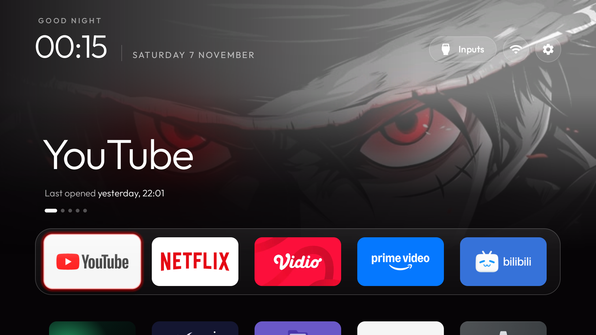

# Performance baseline, 2026-11-07

Taken before the theme-customization work on `feat/theme-customization`, so later changes have numbers
to compare against. Read-only: nothing was built, installed or changed on the TV for these numbers.

## Setup

| | |
|---|---|
| TV | TCL T6C, board G10, Realtek `rtd6748`, 1.7 GB RAM (`MemTotal: 1807408 kB`) |
| Android | 12 (SDK 31), firmware `STT2.230203.001` |
| Launcher | `com.gathin.tvhome` 3.4 (versionCode 13), built from `424672d3` |
| Theme on the TV | `examples/tcl-t6c-indonesia/theme/config.json` plus `"ambient_glow": false`; cinematic Home, glass dock, 5 columns, `advanced_effects` on |
| Client | `tools/tv.py` over network ADB |

## Memory, Home idle 30 s

`dumpsys meminfo com.gathin.tvhome`, after Home had been in front and untouched for 30 seconds
(the wait ran on the TV, and Home was checked to be focused before and after).

| Metric | KB |
|---|---|
| **TOTAL PSS** | **53,580** |
| **TOTAL RSS** | **133,876** |
| TOTAL SWAP PSS | 664 |
| Java heap (PSS / RSS) | 4,972 / 14,236 |
| Native heap (PSS / RSS) | 21,924 / 22,664 |
| Code (PSS / RSS) | 9,580 / 92,076 |
| Stack (PSS) | 392 |
| Graphics (PSS) | 0 (this firmware does not report GPU memory per app) |
| Private other (PSS) | 1,396 |
| System (PSS) | 15,316 |

Objects: 262 views, 4 activities, 4 ViewRootImpl.

System at that moment (`top`): 28,572 KB free of 1,807,408 KB, swap 404,236 KB used of 665,596 KB.

## CPU, Home idle

`top -n 1 -b`: `com.gathin.tvhome` at **0.0 %CPU**, RES 110 MB, 6.2 %MEM. Whole system 340 % idle of
400 %; the busiest process was the vendor's `rtkm_ai` at 36.6 %.

## Frames, 30 s of D-pad on Home

`dumpsys gfxinfo com.gathin.tvhome reset` at 00:15:40, then about 30 seconds of D-pad navigation on Home
with the real remote (dock left and right, down into the grid and back), then `dumpsys gfxinfo` at 00:18:11.

| Metric | Value |
|---|---|
| **Total frames rendered** | **923** |
| **Janky frames** | **3 (0.33 %)** |
| Janky frames (legacy) | 0 (0.00 %) |
| Frame time p50 / p90 / p95 / p99 | 11 / 13 / 13 / 15 ms |
| GPU time p50 / p90 / p95 / p99 | 8 / 9 / 10 / 10 ms |
| Missed vsync | 0 |
| High input latency | 143 |
| Slow UI thread | 0 |
| Slow bitmap uploads | 0 |
| Slow issue draw commands | 2 |
| Frame deadline missed | 3 |

Histogram: most frames between 9 and 13 ms; 6 frames over 16 ms, none over 19 ms.

## Screenshot



## Repeat

```bash
TV_HOST=<tv ip> tools/tv.py 'sleep 30; dumpsys meminfo com.gathin.tvhome; top -n 1 -b | grep tvhome'
TV_HOST=<tv ip> tools/tv.py 'dumpsys gfxinfo com.gathin.tvhome reset'
# 30 s of D-pad on Home with the remote, then:
TV_HOST=<tv ip> tools/tv.py 'dumpsys gfxinfo com.gathin.tvhome' | grep -E 'Total frames|Janky|percentile'
TV_HOST=<tv ip> tools/tv.py --screenshot docs/baseline/<date>-home.png
```
