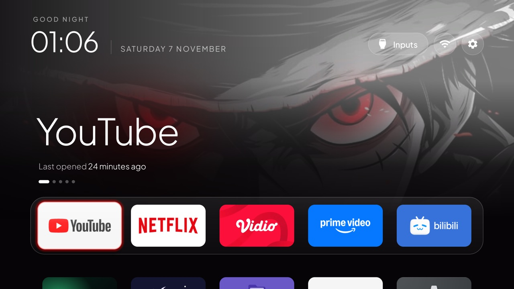
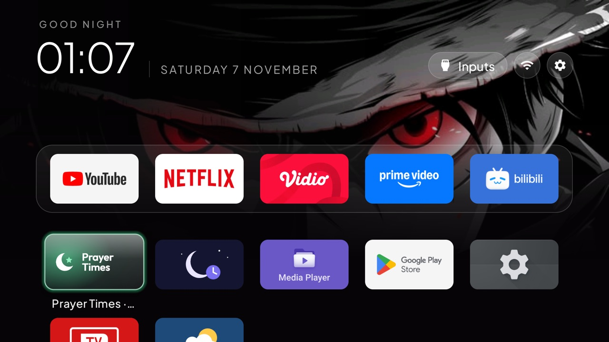
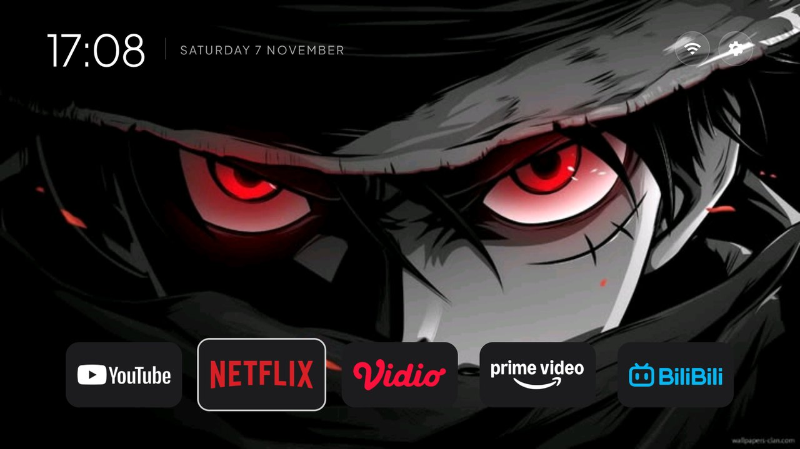
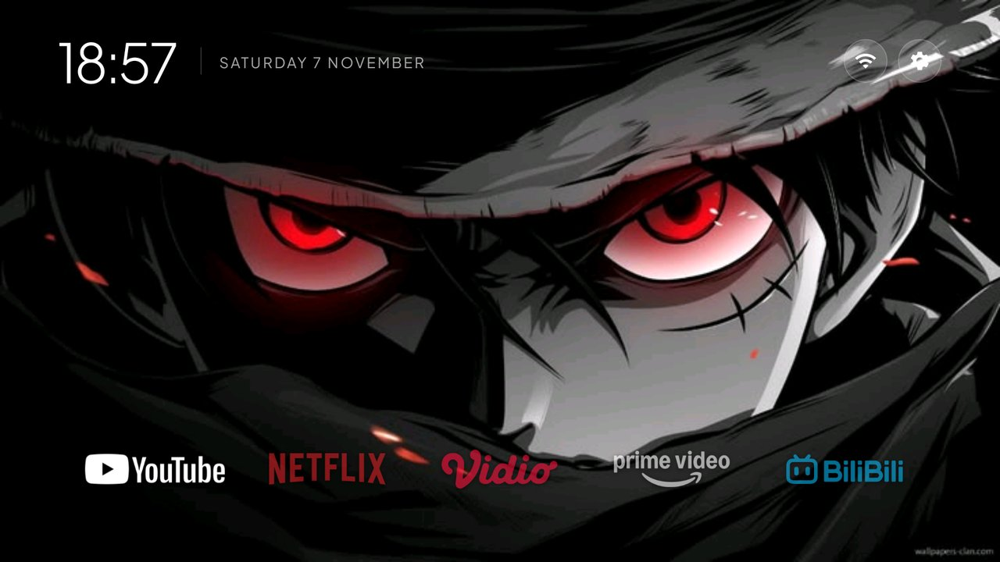
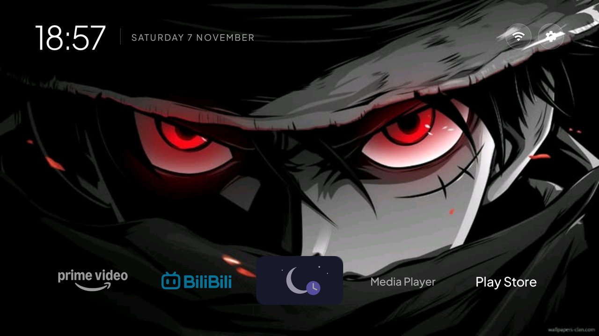
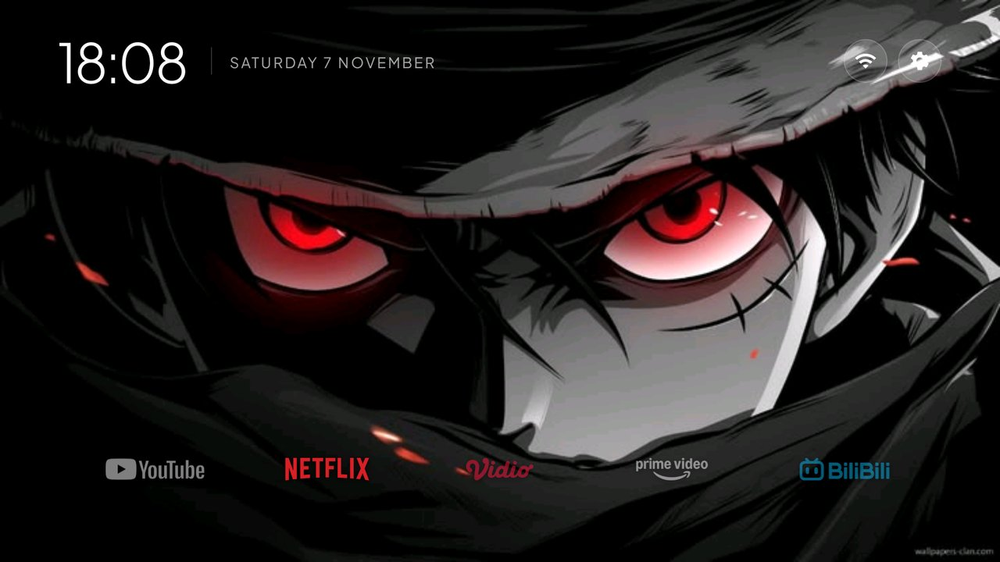
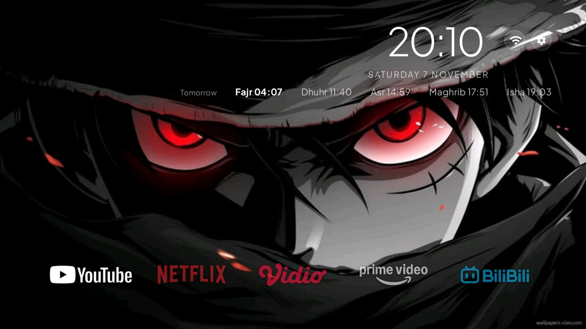

# Switches on a TV

Every new key a theme can set (the Keys table in [`themes/README.md`](../themes/README.md)) gets a
screenshot of what it does on a real TV, and this table is where they are listed: the repo and
[cleanyour.tv/addons#switches](https://cleanyour.tv/addons#switches) both show them from here. Most
keys from before this rule still have none; a screenshot for one of them is welcome.

## Adding a key

A new key needs a screenshot. Put it in `docs/switches/<key>.jpg` (an existing screenshot in the
repo that shows the key at work also counts) and add a row below:

- From a real TV, with the key set, as a JPEG or PNG, 16:9 and no wider than 1920 px (1280×720 is
  plenty), under 300 KB.
- Show where the key changes something you can see. For a key that maps a remote button, show the
  screen the button opens; for one that changes behaviour only, show the setting's effect, such as
  the panel, the menu or the app that comes up.
- Blur anything personal: Wi-Fi names, people, addresses.

`tests/test_switches.py` checks that every new key has a row here with an image that exists and
fits the rules. A row may show more than one picture - `vpn_pill` carries the pill up and the pill at
rest - and every picture in a row is held to those rules, not only the last one. Keys from before the
rule sit on its wanted list until a screenshot arrives.

## Screenshots

| Key | Screenshot |
|---|---|
| `columns` |  |
| `glass_style` |  |
| `sky_intensity` |  |
| `wallpaper_rotation_minutes` |  |
| `festival` |  |
| `seasonal_skin` |  |
| `settings_key_panel` |  |
| `home_idle_clock_minutes` |  |
| `back_opens_clock` |  |
| `gamepad_passthrough` |  |
| `home_ignore_channel_keys` |  |
| `consume_volume_keys` |  |
| `wifi_status_warnings` |  |
| `top_bar_apps` |  |
| `show_greeting` |  |
| `header_white` |  |
| `clock_wallpaper` |  |
| `clock_wallpaper_dim` |  |
| `clock_glow` |  |
| `open_on_start_choice` |  |
| `open_on_start_network_wait` |  |
| `open_on_start_on_wake` |  |
| `single_row` |  |
| `dock_band_all` |  |
| `uniform_tiles` |  |
| `lunar_date` |  |
| `dock_band` |  |
| `show_library_pill` |  |
| `library_ok_opens` |  |
| `library_excluded_apps` |  |
| `date_below_clock` |  |
| `locale` |  |
| `power_on_home` |  |
| `home_long_press_home` |  |
| `vpn_pill` |   |
| `icon_only_vpn` |   |
| `power_on_home_always` |  |
| `inputs_connected_only` |  |
| `inputs_cec_state_only` |  |
| `icon_tiles` |  |
| `game_day` |  |
| `clock_format` |  |
| `glow_snap` |  |
| `font` |  |
| `font_scale` |  |
| `app_logos` |  |
| `tile_style` |   |
| `focus_frame` |  |
| `focus_scale` |  |
| `unfocused_opacity` |  |
| `header_position` |  |
| `clock_size` |  |
| `prayer_times` |  |
| `prayer_latitude` |  |
| `prayer_longitude` |  |
| `prayer_ihtiyat` |  |
| `top_button_size` |  |
